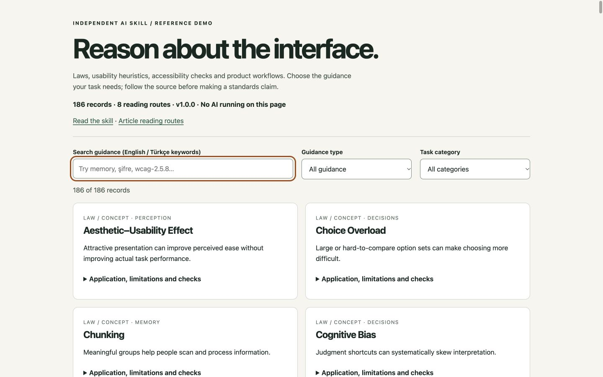

# UX Principles — 1.0.0

A source-linked AI skill for explaining UX, reviewing interfaces and writing reusable interaction rules. It works with your project's visual language and answers in the user's language.

**186 records · 8 article routes · offline lookup · searchable reference browser**

| Collection | Coverage |
| --- | ---: |
| UX laws and concepts | 30 |
| Nielsen usability heuristics | 10 |
| WCAG 2.2 active success criteria | 86: 31 A, 24 AA, 31 AAA |
| ARIA APG component review prompts | 30 |
| Practical product workflows | 30 |

Use it for forms, navigation, accounts, authentication, errors, feedback, recovery, responsive layout, content, localization, data displays, motion, performance, research, AI interaction and design-system rules. Each collection identifies its authority and limitations. See the [coverage contract](skills/ux-principles/references/scope.md) for exact scope and exclusions.

## Türkçe: Bu paket ne yapıyor?

AI'a yalnızca ilke adlarını ezberletmez. Ekrandaki kanıtı ilgili kuralla ilişkilendirir; neyin değişmesi gerektiğini, nedenini ve nasıl kontrol edileceğini açıklar. Psikoloji ilkelerini, kullanılabilirlik önerilerini ve erişilebilirlik standartlarını birbirinden ayırır. Görmediği davranışı test edilmiş gibi sunmaz.

Gönderilen [UX Design Institute yazısındaki](https://www.uxdesigninstitute.com/blog/laws-of-ux/) 21 ilkenin tamamı mevcut 30 ilkenin içindedir. Yazı yeni 21 kural eklemiyor. Bu sürümün kapsamı o listenin ötesine geçer. “UX'e dair dünyadaki her şey” gibi doğrulanamaz bir iddia yerine, kapsadığı kaynakları ve alanları açıkça tanımlar.

## Install

Copy the complete `skills/ux-principles` folder into your Codex skills directory, normally `~/.codex/skills/`. Keep all subfolders together. Review an existing folder of the same name before replacing it. Open a new session if it is not discovered yet.

For another agent supporting `SKILL.md`, use its documented skill location. Without native skill support, attach the skill and relevant references as context. No hosted service, credentials, paid API or MCP server is required. Python 3.9+ is optional for lookup; the Markdown and JSON can be read directly.

## Use

```text
$ux-principles Bu ödeme akışını incele. Kanıtı, ilgili ilkeyi, düzeltmeyi ve kontrol adımını açıkla. Görmediğin davranışları varsayma.
```

```text
$ux-principles Yeni projem için giriş, form, modal ve hata durumlarının kurallarını yaz. WCAG 2.2 AA hedefle; mevcut tasarım dilini koru.
```

```text
Use $ux-principles to explain Hick's Law with an original example, a limitation and a source.
```

The agent loads only relevant references. A comprehensive review covers applicable flows and states; it does not force all 186 records onto every screen.

## Local reference browser

From the repository root:

```sh
python3 -m http.server 8765 --bind 127.0.0.1
```

Open `http://127.0.0.1:8765/skills/ux-principles/demo/`. Search English text, Turkish workflow keywords or exact IDs, then filter by guidance type and category. The page reads local JSON; it does not run an AI, send uploads or track visitors. Source links require internet access.



[Mobile view](skills/ux-principles/demo/mobile.jpg).

## Offline lookup

From the repository root:

```sh
python3 skills/ux-principles/scripts/lookup.py --query "şifre"
python3 skills/ux-principles/scripts/lookup.py --id wcag-2.5.8
python3 skills/ux-principles/scripts/lookup.py --target AA --json
```

`--target AA` returns all 55 A+AA criteria; `--level AA` returns only the 24 labelled AA. Search is lexical, not semantic translation. Unknown exact IDs return exit code 1; an ordinary search with no matches returns a valid empty result.

## Documentation and verification

- [Skill entrypoint](skills/ux-principles/SKILL.md), [routing index](skills/ux-principles/references/index.md) and [review method](skills/ux-principles/references/review-method.md).
- [Catalog/version manifest](skills/ux-principles/references/catalog.json) and [source ledger](docs/source-ledger.md).
- [Authored worked review](skills/ux-principles/demo/expected-output.md) and [example prompts](skills/ux-principles/demo/PROMPT.md).
- [Actual independent forward-test answers](evals/results-1.0.0.json), [evaluation prompts](evals/cases.json) and [validation record](docs/validation.md).

Run `python3 scripts/validate.py` to check data integrity, coverage, local links, portable paths and lookup behavior. Eight independent forward-test answers were qualitatively reviewed; this is a bounded smoke test, not a benchmark of every model or all 186 records. The reference browser was checked on desktop and narrow viewports. This does not certify accessibility of the demo or of a product reviewed with the skill.

## Sources and licensing

Sources were reviewed on 11 October 2026. This is an independent package, not an official product of Jon Yablonski, NN/g, W3C or the other source organizations. Original code, prompts and examples use the [MIT license](LICENSE). External articles, posters, illustrations and complete standard text are not bundled or relicensed; see [NOTICE](NOTICE). Follow the per-record source for authoritative text and its terms.

The accessibility collection is a complete **index with original test prompts** for WCAG 2.2's active criteria, not a replacement for the full normative standard and its exceptions. UX laws and heuristics are context-dependent reasoning aids. No usability, conversion, scientific or legal compliance outcome is guaranteed.

## Contribute and maintain

Preserve stable IDs, use primary sources, date reviews and distinguish original advice from source requirements. Include concrete checks and exceptions; do not copy source prose or artwork. Update coverage counts and evidence when inventories change. Run validation and relevant behavior cases before submitting. See [release notes](docs/release-1.0.0.md).
